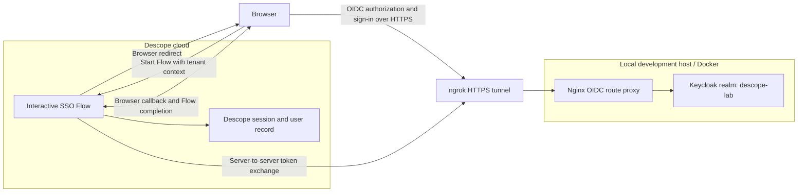

# Keycloak-to-Descope OIDC SSO: A Verified Integration Lab

**Independent technical case study | October 18, 2026**  
**Author:** Michael K. Levesque  
**Environment:** Non-production Descope Free Plan and a local Docker/WSL 2 identity lab  
**Verification status:** One successful interactive SSO sign-in, Descope session response, and Just-in-Time (JIT) user creation. **Not production-ready.**

## At a glance

This lab connected a self-managed **Keycloak** realm to a **Descope** tenant using OpenID Connect (OIDC) Authorization Code Flow. Descope ran an isolated interactive Flow; Keycloak authenticated the test user through an ephemeral HTTPS development tunnel; Descope completed the callback, issued a session, and created the federated user in the intended tenant.

The most valuable lesson wasn't merely getting the login to work. It was isolating four different failure domains: a browser/proxy path, a token-exchange error, an inaccurate-seeming Console warning, and a nonblocking theme-resource error. Each was assessed using evidence rather than changing multiple settings at once.

**Evidence:** On October 18, 2026, the Descope Flow Runner displayed **“Authentication Completed!”**, showed a session response, and the Descope Users screen subsequently displayed an **Active** user with **OIDC** indicated. The user details associated that login with the intended tenant. This evidence supports one successful integration run; it does not establish security assurance, production suitability, or complete negative-test coverage.

## Architecture

Fig. 1 — Logical trust and routing boundaries. The Mermaid source is also available in [`diagrams/`](diagrams/). This is not a captured packet trace. The tunnel is a temporary development ingress, not a recommended production IdP endpoint.

## The implemented pieces

| Layer | Function in the demonstration |
|---|---|
| Keycloak `descope-lab` realm | Test IdP, user directory, OIDC endpoints |
| Keycloak `descope-sso` client | Client authentication enabled; Authorization Code (Standard) Flow; client ID/secret authentication |
| Local Nginx proxy | Restricted forwarding of selected Keycloak OIDC routes |
| ngrok | Temporary externally reachable HTTPS origin for the IdP |
| Descope tenant `keycloak-oidc-sso-lab` | Saved OIDC provider, JIT provisioning, test-user tenant context |
| Descope Flow `keycloak-oidc-sso-test-v1` | Minimal `START → SSO → END` integration check |
| Browser-based Flow Runner | End-user redirect, sign-in, response and session confirmation |

No React customer portal, Node.js resource-server authorization, passkey enrollment, independent TOTP flow, SCIM synchronization, or cross-tenant RBAC exercise was completed as part of **this** OIDC milestone.

## Build and validation narrative

1. **Isolate the experiment.** Preserve five starter Flows, the separate `lab-authentication-v1` duplicate, the AccessFlow test tenant, and Grafana's `portfolio-lab` workstream. Use a dedicated `descope-lab` realm, `descope-sso` client, Descope SSO test tenant, and new SSO Flow.
2. **Establish consistent discovery metadata.** Confirm that the public OIDC discovery document advertises the expected HTTPS issuer and endpoints. A previous Grafana issuer mismatch in a different realm reinforced why issuer identity matters but does not prove anything about this separate connection.
3. **Configure confidential-client OIDC.** In Descope, select Authorization Code, a client ID and confidential secret, `openid profile email` scopes, public OIDC endpoints, JIT provisioning, and a provider `sub`-to-login mapping. Keep secret values outside this documentation.
4. **Construct a minimal Flow.** Save `START → SSO → END`. Supply `tenant=keycloak-oidc-sso-lab` at run time; without the correct tenant, Descope cannot reliably select the intended tenant's SSO provider.
5. **Run the browser test.** The browser was redirected through the temporary public origin to Keycloak. After correcting an autofilled administrator account to the dedicated realm test identity and later re-entering the existing client secret, the Flow completed successfully.
6. **Verify the result separately.** Confirm both the Flow Runner's successful session response and Descope's subsequently created active OIDC user. The second check is independent confirmation that an identity record exists.

Read the [configuration record](docs/configuration-record.md), [verification matrix](docs/verification.md), and [failure analysis](docs/troubleshooting.md) for supported details and limits.

## What failed and what we learned

| Symptom | Investigation | Evidence-supported result |
|---|---|---|
| Initial Flow Runner error: “Got empty last screen details” | Minimal screenless Flow; run-time tenant context absent | Adding the tenant context allowed browser redirection; original cause not isolated |
| Direct Python SSO API attempt returned `403` | Response was Cloudflare `error code: 1010` | A gateway rejection, **not** evidence that the tenant's SSO was disabled |
| Descope token exchange failed | Keycloak logged `CODE_TO_TOKEN_ERROR`, `client_not_found` | Keycloak could not resolve client identity on that attempt; exact root cause unproven |
| Token endpoint route suspected | Incomplete POSTs got JSON `401`; deliberately wrong secrets yielded `invalid_client_credentials` with client ID identified | Proxy forwarded the tested request forms correctly; fake secrets were expected to fail |
| Tenant `theme.json` returned `404` | Flow Runner explicitly fell back to default theme | Nonblocking display-resource issue; authentication later succeeded |
| Tenant page warned project-level SSO disabled | Flow Runner's SSO action nonetheless initiated and completed | Flow-based SSO works here; other API/SDK SSO initiation modes remain unverified |

**Root-cause integrity:** Re-entering the existing Keycloak secret preceded success. It **does not prove** that the original saved secret was wrong or that this alone fixed the earlier `client_not_found` event. Details in [troubleshooting](docs/troubleshooting.md).

## Scope and limitations

This is a single-user, single-tenant, non-production learning experiment. It does not demonstrate resilient availability, browser compatibility, hardening, authorization policy enforcement, session revocation, IdP logout propagation, clean-room redeployment, or negative-path end-to-end test coverage. The private Keycloak backup passed archive/checksum checks; restore was not tested. `localhost` and ephemeral tunneling are **lab-only conveniences**.

**The repo does not ship executable infrastructure or a ready-to-deploy identity stack.** Keycloak and Nginx live configs and the original Descope Flow export are held privately pending review. See [security and release](docs/security-and-release.md).

## Navigate the documentation

- [Configuration and scope](docs/configuration-record.md) — what was configured versus what has not been independently inspected
- [OIDC authorization sequence](docs/authentication-sequence.md) — browser and back-channel behavior
- [Verification matrix](docs/verification.md) — observed vs untested outcomes
- [Troubleshooting record](docs/troubleshooting.md) — causal restraint and practical diagnostics
- [Security and publication boundaries](docs/security-and-release.md) — what must remain private and what production would require
- [Source and evidence register](docs/sources-and-evidence.md) — official references, observation IDs, publication gaps

## Attribution and independence

This case study describes an independently built personal lab. It is **not** a Descope or Pepper commission, endorsement, security certification, or product manual. Screenshots from private consoles, any real token, credentials, temporary authorization codes, and personal paths are intentionally excluded from this publication candidate. Descope and Keycloak are trademarks of their respective owners.
