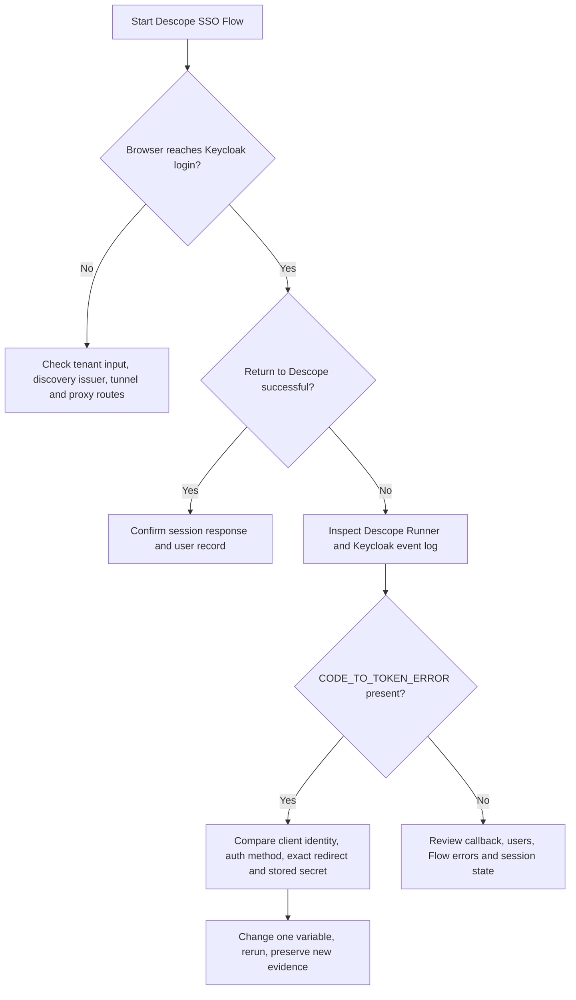

# Troubleshooting: From `client_not_found` to a Successful SSO Sign-in

## Failure map



This decision tree is a **diagnostic aid**, not proof that each branch was exercised.

## Incident 1: Run Flow reported an empty “last screen”

**Symptom:** `Failed get last screen. Got empty last screen details` on a minimalist, screenless `START → SSO → END` Flow.

**Evidence:** Its Runner configuration included a blank `tenant` input. The test operator filled the tenant with `keycloak-oidc-sso-lab` and successfully reached Keycloak's login page. Whether the original error resulted from missing tenant context, screenless default error handling, or both was not isolated.

**Lesson:** Supply tenant routing explicitly in tenant-specific Flow tests; avoid interpreting vague UI errors as proof of a bad IdP configuration.

## Incident 2: Direct API diagnostic was blocked before reaching Descope

**Symptom:** Python code calling Descope's SSO start endpoint returned `HTTP 403`, `Content-Type: text/plain`, `error code: 1010`, `Server: cloudflare`.

**Evidence-based interpretation:** Cloudflare rejected the request. This diagnostic did **not** demonstrate that Descope's project-level SSO was disabled or that OIDC itself was broken. Rather than attempt to bypass Cloudflare, the operator used the documented interactive Flow Runner.

## Incident 3: Authorization-code exchange failed

**Symptom:** Descope Runner displayed `Token exchange with SSO provider failed` after browser login.

**Keycloak event excerpt (secrets removed):**

```text
CODE_TO_TOKEN_ERROR  realmName="descope-lab"
clientId="null"       error="client_not_found"
grant_type="authorization_code"
```

**Targeted tests:**

- Intentionally incomplete POST to local proxy and public HTTPS token endpoint: HTTP `401` with `application/json` responses. This established response-path reachability, not a successful exchange.
- Deliberately wrong client secret via HTTP Basic: Keycloak logged `clientId="descope-sso"` and `invalid_client_credentials`.
- Deliberately wrong client secret using `client_id` and `client_secret` form parameters: Keycloak again identified `descope-sso` and rejected the fake secret.
- Saved Descope settings visibly contained `descope-sso`, Client Secret, Authorization Code and the correct public realm endpoints; the masked secret proved a value was stored, but **not** that it matched Keycloak.
- Keycloak confirmed Client authentication On, Standard Flow On, Client ID and Secret selected.

**Subsequent action:** The existing Keycloak secret was copied again into the Descope tenant and the Flow rerun using the correct realm test user. **This time authentication completed.**

**Root cause:** **NOT PROVEN.** The earlier `client_not_found` shows Keycloak did not resolve the client identity on that request. It does not prove whether the old secret was stale, a client ID field was absent from the actual exchange, an intermediary altered a particular request, or some other intermittent/configuration issue. No sanitized capture of Descope's original token POST is available. Attribute the successful outcome to the verified *sequence of actions*, not an invented single-cause fix.

## Incident 4: Password manager entered the administrator login

An early login used `keycloak-admin` from an unrelated administrator context while the browser was on the `descope-lab` realm. Keycloak correctly rejected it. The dedicated `descope.tester` account was then used. This is an identity/realm selection issue, separate from token exchange.

## Incident 5: Tenant theme returns 404

The Runner logged `theme.json` HTTP `404` for tenant-specific styling, followed by `No tenant style exists, using project default theme.` The successful run still displayed theme warnings. Treat this as a nonblocking user-interface asset issue, not evidence of authentication failure.

## Incident 6: “SSO is disabled under project authentication methods”

The tenant SSO settings page continued to display this warning, even though an SSO action in the Flow Runner initiated Keycloak login, completed, issued a Descope session, and created the federated user. The Console warning's full relationship to other API/SDK triggers was **not established**. Document it as an unresolved product/UI behavior; do not claim all SSO starts are enabled or disabled.

## Practical takeaway

Use a layered method: confirm browser reachability → distinguish gateway errors from product errors → inspect the IdP's `CODE_TO_TOKEN_ERROR` → test client recognition using deliberately invalid credentials **without real secrets in output** → compare actual stored settings → change one variable → verify both session and user record. Preserve the inconclusive parts as inconclusive.
